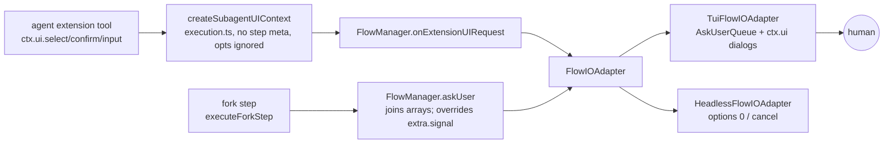
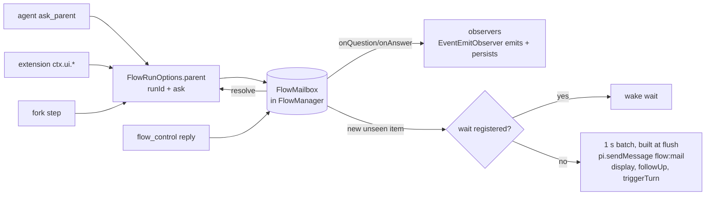

# Design

## Context

See proposal.md (Why). Current paths for a question:

Verified constraints (doubt-review cycles 1–3):
- `ask_user` exists only in the main session (`index.ts:397`); flow agents reach a human only through `ctx.ui.*` of agent extension tools. The guard's `ask_user` rule is unchanged.
- `extraCustomTools` = main-session `flow:register-tool` list, filtered per agent by `tools:`; cannot carry a per-spawn tool.
- `autonomousModeEnabled` defaults to `true`, global, persisted.
- `ctx.hasUI`: true in interactive and RPC, false in print/JSON. `ctx.isIdle()` exists.
- `runDagSegment` runs a wave with `Promise.all` inside `raceWithAbort`; abandoned children's rejections are unobserved.
- `session.abort()` waits for idle; a parked tool `execute` must race its own `signal`.
- `haltController` aborts `options.signal` on halt and user abort. Spawns get it; `FlowManager.askUser` overrides `extra.signal` with the user-abort signal only.
- Markers are appended by `EventEmitObserver.onFlowComplete` → `emitCompletionMarker` (and at start), guarded by "no user message".
- Events persist only via `EventEmitObserver.emit` → its single `FlowEventPersister` (one `seq`), for channels in `FLOW_EVENT_NAME_MAP`.
- Slash commands call `flowManager.start`; `flow:run` → `runFlowByName` (returns nothing); `FlowManager.start` returns `void`; typed-input validation runs inside `runFlow` after start (contradicts `typed-flow-input`).
- `FlowResult.forks[].answer` is `string`; `FlowCancelledError` is public, exported from `flow-execution.ts`.
- `.pi/extensions/batch-apply.ts` emits `flow:run` from the session itself.

## Goals / Non-Goals

**Goals:** one in-process mailbox for every question source; the same push / wait / reply loop as `AgentControl` (pi-dashboard-subagents); detached runs never ask.

**Non-Goals:** sharing code with pi-dashboard-subagents; durable questions across restarts; a human dialog fallback; freeing a parked agent's wave; changing the slash-command start path beyond attachment.

## Decisions

### D1 — Attachment is per run
`FlowManager.start({..., attached})` returns `{runId}`. Slash command: `attached = hasUI` (captured at `session_start`). `runFlowByName(name, {task, flowInput, notifyParent})` returns `{runId} | {rejected: reason}` and passes `attached = !!notifyParent`. `flow_run` → `runFlowByName(..., notifyParent: true)`. `batch-apply.ts` adds `notifyParent: true`. Alternative (attach every run in a UI session) rejected: host automations finalize on `agent_end`, push turns would emit it mid-flow.

### D2 — Mailbox owned by FlowManager, handed to the engine

New `FlowRunOptions.parent?: { runId: string; ask(q: QuestionSpec, signal?: AbortSignal): Promise<Answer> }`. `FlowManager` sets it only for attached runs; `runFlow` / `runFauxFlow` without it are detached (public API: additive, documented). Engine code asks only through `options.parent`; when absent it uses `options.askUser` (headless adapter) as today.

Question record: `{id, runId, stepId, agent, item?, kind: agent|extension|fork, question, options?, multiSelect?, allowCustom?, canDecide?, timer?, pushed, waitSeen, resolve}`. Id: `q-` + 12 hex chars of a UUID (unique within the process; no counter). The adapter is always `HeadlessFlowIOAdapter` (with optional `ui` for `notify`); `session_start` no longer swaps adapters.

### D3 — `ask_parent` is a per-spawn tool
New `SpawnOptions.askParent?: (args, signal) => Promise<string>`, set in `flow-execution.ts` only for worker `agent` steps and fan-out instances when `options.parent` exists (closure has `stepId`/item). `spawnAgent` drops any same-named entry from `customTools`, appends the definition and passes `alwaysAllowedTools: ["ask_parent"]` to the guard. `execute` validates args, calls `parent.ask`, races its `signal` (abort → close `via: "cancel"`). `agent-validate` adds `ask_parent` to known tools.

### D4 — Extension prompts
New `SpawnOptions.uiMeta` (`stepId`, item) set by `flow-execution`; `createSubagentUIContext` adds it to the request and forwards `opts.signal` / `opts.timeout`. `FlowManager.onExtensionUIRequest`: attached + worker agent → `parent.ask` (`select` → options, `confirm` → `["yes","no"]` → boolean, `input` → free text), closed on the prompt's signal/timeout; decision agents/deciders and detached runs → cancelled.

### D5 — Forks
- `FlowRunOptions.askUser` answer widens to `string | string[]`; `FlowManager` stops joining and combines `extra.signal` with its abort signal (`AbortSignal.any`) instead of overriding. `ctx.forks[...]` records the answer as given (a list for multi-select — the pre-existing `runFlow` contract, though `FlowResult.forks[].answer` is typed `string`); summaries and fork context use the joined text.
- With `options.parent`: skip the `isAutonomous()` short-circuit; ask with `canDecide = hasAutoDecider(step)`, `signal: options.signal` (halt closes it). Reply mapping: option(s) → branch(es); `decide` (+notes) → internal `__auto_decide__` / `__custom_decide__`; free text → `__custom_decide__` with the text as notes; both only when `canDecide`.
- Exhausted delegation: `on_error` set → existing routing; else `executeForkStep(..., {reask: reason})` once with `canDecide: false`, no free text.
- Closed question → the fork resolves to a cancelled step result (no rejection into an abandoned `Promise.all`). `FlowCancelledError` stays in `flow-execution.ts`.
- `ask_timeout_s` / `ask_default` parsed and validated in `parseForkStep` (throws → every load path), mirrored as `tools/flow-validate.ts` diagnostics; timeout resolves with `ask_default`.

### D6 — Timeout and default
Timer starts at open; on fire: close (`via: "timeout"`), resolve with `default` or `"The parent did not answer within <N>s. Decide yourself, state your assumption in your result, and continue."`.

### D7 — Closing
`FlowManager` calls `mailbox.closeRun(runId)` when the run promise settles (any status), **before** `onFlowComplete`, and on `abort()`. Signals close questions on halt or step abort (D3–D5). `OrphanedRun` gains the open question ids (persisted `flow_question` without `flow_answer`); `reconcileOrphanedRun` persists their `flow:answer {via:"cancel"}` before the terminal record.

### D8 — Push and wait
- Push (attached only): 1 s batch; at flush, items = open questions with `!pushed && !waitSeen` plus the run outcome if not yet pushed or returned; empty → nothing sent; skipped while a `wait` is registered. Marks `pushed`.
- `wait`: returns at once with open questions `!waitSeen` and the outcome if not yet returned by `wait`; else registers a waiter until a new such item, timeout (default 300 s, max 600 s) or its tool `signal`. Marks `waitSeen`. No busy loop (returned questions never end a later wait); no stall (pushed-but-unseen questions still end the next wait). Duplicates between a queued push and `wait` are harmless (`not_pending`).
- `status` is a pure read. All `flow_control` actions require an active attached run.

### D9 — `flow_run` and pre-start checks
`flow_run` rejects a missing `task` on `task_required` flows as an argument error, then calls `runFlowByName`. `runFlowByName` gains the typed-input check (moved from `runFlow` into the shared pre-start checks, emitting the rejection), satisfying `typed-flow-input`. `runFlow` keeps its own check for programmatic callers.

### D10 — Events
`FlowObserver.onQuestion(q)` / `onAnswer(q, via)`. `EventEmitObserver` emits `flow:question` / `flow:answer` with `runId` and persists them through its single persister; `FLOW_EVENT_NAME_MAP` gains `flow_question` / `flow_answer`. Dashboard rendering is a follow-up.

### D11 — Marker turn guard
`FlowEventPersister` checks `isIdle()` (from the captured session ctx) before appending a start or completion marker; when not idle it defers the marker to the next `agent_end`, then applies the existing user-message guard. The completion signal stays unconditional.

### D12 — Removal
`TuiFlowIOAdapter`, `AskUserQueue`, checkbox/select/notes dialogs deleted; `HeadlessFlowIOAdapter` gets an optional `ui` for `notify`.

## Risks / Trade-offs

- [Parent never answers → the whole wave stalls] → accepted; visible via `status`, `flow:question`, push; `cancel` recovers; `timeout_s` / `ask_timeout_s` available.
- [Fork and extension prompts move from humans to the parent model; autonomous toggle no longer affects attached runs] → intended (BREAKING, CHANGELOG); parent escalates with `ask_user` or delegates with `decide`.
- [Detached runs in UI sessions lose the human dialogs: forks take option 0 / decider, extension prompts cancel] → BREAKING, listed; hosts pass `notifyParent: true` to get questions.
- [`flow:run` with invalid typed inputs is now declined instead of started-then-failed] → conforms to `typed-flow-input`; both are terminal `flow:complete`.
- [Push turns cost parent tokens] → unseen questions and run end only; batched; none while waiting.
- [Print/JSON-mode `flow_run`: pushes may not get a turn] → the parent must `wait`; documented in the tool description.
- [Dashboard does not yet render the new events] → follow-up; persisted for replay.

## Migration Plan

Single change; two new persisted event kinds. Rollback = revert. Follow-ups: dashboard mapping; `batch-apply-example` operator requirement.
