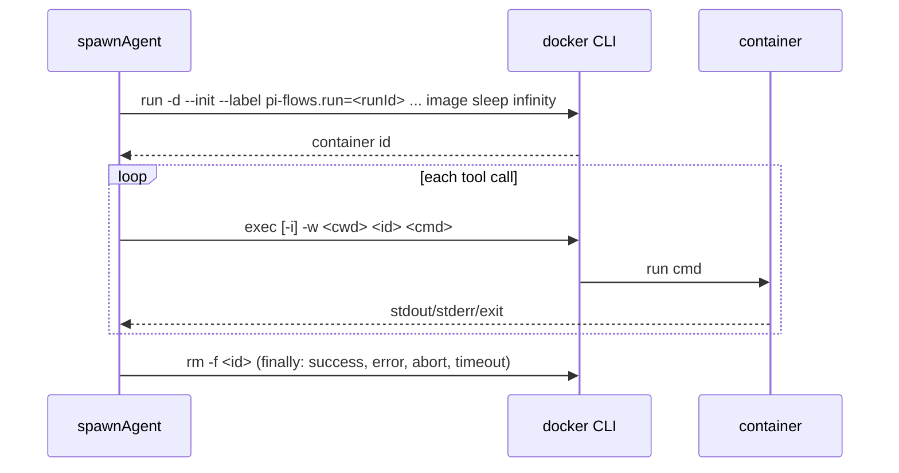

## Context

See proposal.md for motivation. Relevant current state:

- `spawnAgent` (`execution.ts`) creates each agent session with `createAgentSession({ tools: undefined, customTools, cwd, ... })`; built-in tools are the SDK defaults, which act on the host. Per-agent extension factories (the guard, `flow:register-agent-extension` factories) are bound to the session.
- pi's built-in tools accept an `operations` backend: `Read/Write/Edit/Ls` operations are plain file calls; `BashOperations.exec(command, cwd, { onData, signal, timeout, env })` runs a command. `grep` and `find` still run ripgrep/fd on the host even with custom operations, so they must be replaced, not just re-backed.
- pi's `gondolin` example overrides all seven built-ins from an extension with `pi.registerTool(...)` and routes them into a VM; this is the pattern to follow.
- Spike (macOS, Docker Desktop 29.9.2, `node:22-slim`): `docker run --network none --read-only --tmpfs /tmp --cap-drop ALL --security-opt no-new-privileges --pids-limit 256 --memory 512m --user uid:gid -v <dir>:<dir>` blocked every escape; container start ≈ 0.22 s; a symlink created in the shared folder leaked a host file through a host-side read.
- The `access:` block parses to nothing today; guard path checks and the skill-glob widening in `execution.ts:379-383` only exist for it.

## Goals / Non-Goals

**Goals:** one-folder confinement for every built-in tool; works with the Docker the user already has; never silently unsandboxed; clear per-OS errors; no behavior change when not enabled.

**Non-Goals:** building images or managing Docker installs; network allowlists (only `none`/`bridge` in v1); gVisor/microVM backends (documented, selectable via `runtime` passthrough only); sandboxing extension/MCP tools or `code` steps; the OS-level (sandbox-runtime) backend; native Windows pi (supported via pi inside WSL2).

## Decisions

**D1 — Inject container-backed tools through an agent extension factory.** A `createDockerSandboxExtension(sandbox)` factory, added to the agent's extension list like the guard, calls `api.registerTool` for `bash`, `read`, `write`, `edit`, `ls` (pi's `create*ToolDefinition(cwd, { operations })` with container operations) and `grep`, `find` (own definitions with the same names and parameter schemas, executing `rg`/`find` in the container; falls back to `grep -rn` when `rg` is missing). Same mechanism as the gondolin example. *Alternative*: pass replacements via `customTools` — rejected until verified that custom tools may shadow SDK built-ins; task 1.1 is a spike that confirms the override wins in an agent session and the guard's declared-tools whitelist still applies.

**D2 — One container per agent run, exec per call.**

Flags: `--network none` (or `bridge`), `--read-only`, `--tmpfs /tmp`, `--cap-drop ALL`, `--security-opt no-new-privileges`, `--pids-limit`, `--memory`, `--cpus`, `--user uid:gid` (Podman: `--userns=keep-id`), `-e HOME=/tmp`, `-v <project>:<project>`, `-v <skillDir>:<skillDir>:ro`, optional `--runtime <runtime>`. Abort/timeout of a bash call kills the exec client and runs `kill -TERM -1` inside the container via a follow-up exec; the container is removed at run end regardless.

**D3 — Same absolute path inside and outside.** The project folder is mounted at its host path, so paths in prompts, tool arguments and outputs need no translation and the symlink check is unnecessary (all resolution happens inside the container). Windows hosts are supported by running pi inside WSL2, where paths are POSIX; native Windows pi fails preflight with that instruction.

**D4 — File operations via exec.** `readFile` → `cat -- 
`; `access` → `test -r`; `writeFile` → `sh -c 'cat > "$1"' _ 
` with stdin; `mkdir` → `mkdir -p`; `stat`/`exists`/`readdir` → `test`/`ls -1A`. ~50–100 ms per call. *Alternative*: host fs on the bind mount — rejected, a background process in the container can swap a symlink between check and use. A persistent in-container helper is a later optimization if latency matters.

**D5 — Preflight, cached per flow run.** Ordered checks with short timeouts; first failure stops: (1) host is POSIX or WSL; (2) CLI on PATH; (3) `<cli> info` responds (report active context); (4) image present, else `pull` (progress via `flow:notify`); (5) arch match → warning only; (6) test mount: `run --rm -v <project>:<project> <image> test -d <project>`; (7) Linux socket EACCES detection. Each failure maps to a message with an OS-specific fix (table below). `/flows:sandbox doctor` runs the same function and prints all results.

| Failure | Detected by | Fix shown |
|---|---|---|
| CLI missing | PATH lookup | macOS: Docker Desktop / OrbStack / Colima; Linux: docker or podman; Windows: Docker Desktop + run pi in WSL2 |
| Daemon down | `info` fails | name context; "start Docker Desktop" / `colima start` / `systemctl start docker` |
| Socket permission | EACCES text | add user to `docker` group, or rootless docker / podman |
| Image unavailable | `pull` fails | name image; `docker pull <image>` when online, or set `flows.sandbox.image` |
| Folder not shareable | test mount fails | name folder; Docker Desktop → Settings → Resources → File sharing |
| Native Windows | `process.platform === "win32"` and not WSL | run pi inside WSL2 |

**D6 — Mode resolution.** Effective backend = `docker` if settings say `docker` or the flow says `sandbox: docker`; otherwise `none`. Resolved once at flow start and frozen for the run; reported via `flow:sandbox-status`.

**D7 — Extension tools.** In docker mode `filterExtensionTools` keeps only names in `trustedTools`; an agent declaring an untrusted extension tool fails at step start (spec). Built-in `finish` and `ask_user` are unaffected (no host file access).

**D8 — Remove `access:`.** Delete `AccessRules`, `parseAccessBlock`, the guard's access branch and the skill-glob widening. Validator: `access` field → error pointing to `flows.sandbox`. The guard keeps the declared-tools whitelist and `finish` handling.

**D9 — Tests.** Unit: argument construction, mode resolution, error mapping, using a fake CLI script on PATH. Integration (`describe.skipIf(!dockerAvailable)`): the spike's escape suite (`../`, `~/.ssh`, rootfs write, network, symlink + `read`, uid of created file, container removed after abort) through real agent tool calls via the faux harness.

## Risks / Trade-offs

- [Plain Docker shares the host kernel] → docs: use `runtime: runsc` (gVisor) for untrusted multi-user input.
- [Exec-per-call latency on file-heavy agents] → acceptable for v1; persistent helper later.
- [Image lacks tools the agent needs (`rg`, `git`, project toolchain)] → `grep` fallback; docs recommend the project's devcontainer image via `flows.sandbox.image`.
- [Orphaned containers after a crash] → label every container `pi-flows.run`; on `session_start`, remove labelled containers older than the configured max run time.
- [Podman rootless uid mapping differs] → `--userns=keep-id` when `cli: podman`.
- [Mac file-sharing performance] → virtiofs default in current Docker Desktop; documented.

## Migration Plan

Opt-in feature, default `none`. The only breaking part is `access:` rejection; CHANGELOG states that it never took effect and how to migrate. Rollback = revert; no persisted state beyond labelled containers, which the cleanup removes.

## Open Questions

- Whether to also mount a git worktree per run instead of the project folder (deferred to the worktree change; the mount path is already a parameter).
