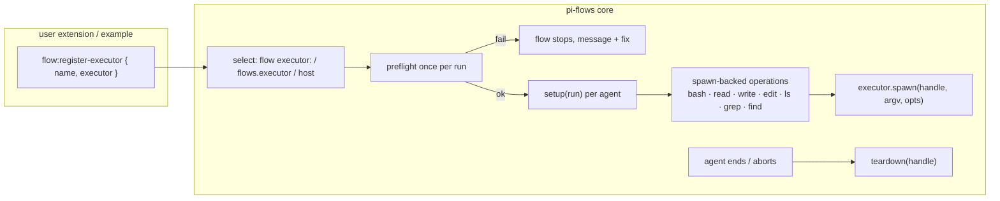

# Design: agent-executor-hook

## Context

- pi's built-in tools accept `operations` (`BashOperations.exec`, `ReadOperations.readFile/access`, `WriteOperations.writeFile/mkdir`, `EditOperations`, `LsOperations`, `GrepOperations`, `FindOperations.glob`). pi-flows creates agent tools in one place (`TOOL_FACTORIES`, `execution.ts`).
- Branch `os/agent-docker-sandbox` (`0c515b2`, not merged) already implements all seven backends over a container `exec` (`sandbox/operations.ts`, `tools.ts`), a Docker CLI runner, container lifecycle and preflight. This change splits that into a generic core (operations over `spawn`) and a Docker example (container + preflight).
- A probe on macOS confirmed the symlink escape when only `bash` is isolated.



## Goals / Non-Goals

**Goals:** a small public executor interface; all seven tools through it; fail closed; no runtime- or OS-specific code in core; a working Docker example.

**Non-Goals:** network allowlists; isolating extension/MCP tools (they need their own boundary); isolating `code` steps; Windows-native paths in core (executors decide).

## Decisions

**D1: Interface.**
```ts
interface FlowExecutor {
  preflight(ctx: { cwd: string; signal: AbortSignal }): Promise<{ ok: true } | { ok: false; check: string; message: string; fix?: string }>;
  setup(run: { cwd: string; runId: string; stepId: string; skillDirs: string[]; signal: AbortSignal }): Promise<unknown>;
  spawn(handle: unknown, argv: string[], o: { cwd: string; env?: Record<string,string>; stdin?: Buffer; onData?: (b: Buffer) => void; signal?: AbortSignal; timeoutMs?: number }): Promise<{ code: number | null; stdout: Buffer; stderr: Buffer }>;
  teardown(handle: unknown): Promise<void>;
}
```
`host` is a built-in object that `setup` returns null for and whose tools use pi's default operations (no spawn path), so behaviour is unchanged.

**D2: Operations over spawn.** Move `sandbox/operations.ts` into `executor/operations.ts` and parameterize it over `spawn`. `bash` runs `["sh","-c",SHELL_WRAPPER,"_",cmd]` (bash if present) with streaming. The file ops are `cat --`, `tee`/stdin writes, `mkdir -p --`, `test -e`, `ls -1A`, `rg`/`grep` argv builders (existing `buildGrepArgv`), and `find` with glob translation. Arguments are argv only.

**D3: Lazy setup.** `setup` runs on the first tool call of an agent run, not at spawn, so agents that never use tools cost nothing. `teardown` runs in `spawnAgent`'s `finally`.

**D4: Selection and settings.** Through the `resolver-agnostic-model-refs` settings helper: `flows.executor` (string) and `flows.trustedTools` (string[]). The flow-level `executor:` parses on `FlowConfig`. Precedence and the no-weakening rule are as specified.

**D5: Preflight caching.** One preflight per run, plus `/flows:executor doctor`. The result is not cached across runs (the daemon may stop).

**D6: Docker example.** `examples/executors/docker/index.ts` is a pi extension that emits `flow:register-executor` for `docker`. It reuses `container.ts`, `docker-cli.ts` and `preflight.ts` from the branch (OS-specific fix texts live here). It has its own settings key `flows.docker` (`image`, `network`, `cli`, limits, `runtime`). The README explains loading it (`pi install` the example path, or copy it).

**D7: `access:` removal.** As in the superseded proposal: a parser/validator error, the guard path checks and skill-dir whitelisting deleted, and the `agent-skills` requirements removed.

## Risks / Trade-offs

- **Spawn-based file ops are slower** than host fs (one process per op). It's acceptable for isolation, and executors can keep a long-lived box.
- **A hostile executor** is trusted code by definition (an extension). Documented.
- **Image toolchain:** file ops need `sh`, `cat`, `ls`, `find`, `mkdir`, and `rg` or `grep` in the box. The Docker example's preflight checks for them.
- **Breaking `access:`** for agents that declared it. Gives a clear migration error.
