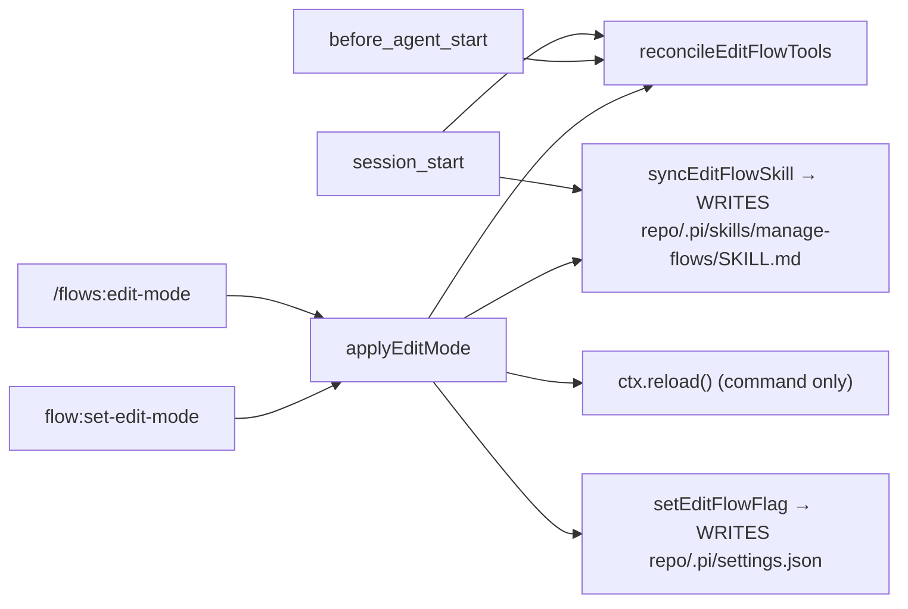
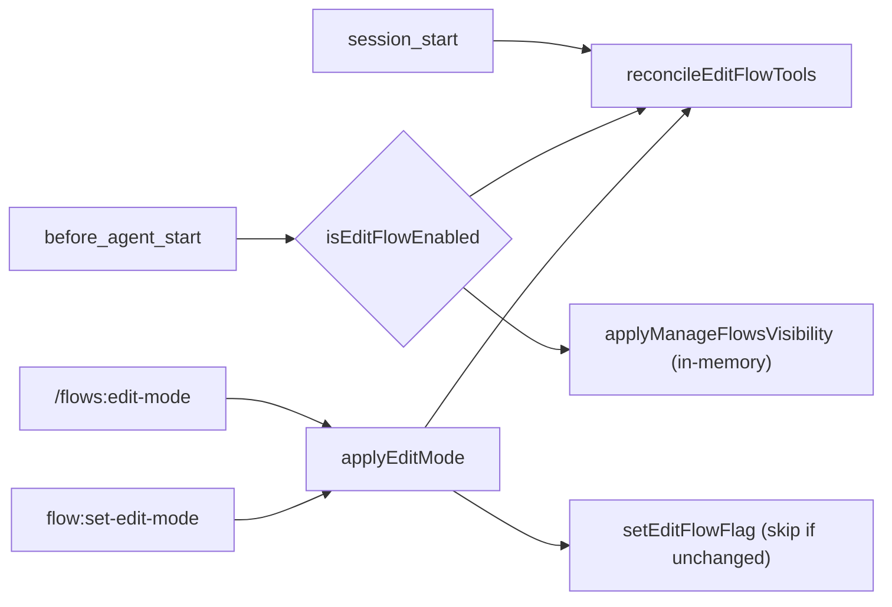

# Design

## Context

See proposal.md (Why). Current wiring in `extensions/flow-engine/index.ts`:

The project-local skill file existed only so the extension could flip `disable-model-invocation`. pi ≥ the current peer exposes two primitives that make the file unnecessary:

- Package manifests can declare skills (`"pi": { "skills": [...] }`).
- `before_agent_start` receives a mutable `event.systemPromptOptions.skills: Skill[]`, where each `Skill` carries `disableModelInvocation`. Mutations apply to that run's prompt.

## Goals / Non-Goals

**Goals:**
- Zero filesystem writes outside the explicit toggle, and the toggle writes only `flows.editFlow` in the project settings.
- One per-turn decision point for tools and skill visibility.

**Non-Goals:**
- Migrating or deleting existing repo files (documented in CHANGELOG only).
- Changing the `flow:set-edit-mode` payload or the tool-activation signal the dashboard observes.
- Changing `isEditFlowEnabled` resolution (project overrides global, no trust gate).

## Decisions

**D1. Register the skill through the package manifest (`"pi": { "skills": ["./skills"] }`).** The skill lives at `skills/manage-flows/SKILL.md` and is already in `files`. It is always reachable via `/skill:manage-flows`.
- *Alternative:* a `resources_discover` handler returning `skillPaths`, applied only when no project copy exists. It is more code, a stale project copy would win on content, and it gives up the useful duplicate-name warning that points users at the leftover file. Rejected.

**D2. Per-turn visibility by skill name in `before_agent_start`.** The existing handler already computes `enabled = isEditFlowEnabled(projectRoot)` for tools. Using that same value, set `disableModelInvocation = !enabled` on every entry in `systemPromptOptions.skills` whose `name === "manage-flows"`. Other skills are untouched. Matching by name (not path) makes leftover project copies follow the setting regardless of their frontmatter. The logic is extracted as a small pure helper (`applyManageFlowsVisibility(skills, enabled)`) next to `edit-flow-reconcile.ts`, so it can also be unit-tested.
- *Alternative:* remove the entry from the array when disabled. Setting the flag matches pi's own semantics ("hidden from model, still invocable") and keeps the list intact for any later handler. The tests accept either; the flag is preferred.
- Unlike tools, this step is not change-gated. The options object is rebuilt per run, so it must be applied every turn. It is an in-memory loop with no I/O beyond the settings read the handler already does.

**D3. `session_start` reconciles tools only.** Drop the `syncEditFlowSkill` call.

**D4. `applyEditMode` = `setEditFlowFlag` + `reconcileEditFlowTools`, no reload.** With no file to re-discover, the reload has no purpose. Both surfaces notify "applies from next turn". The command keeps `ctx.ui.notify`.

**D5. `setEditFlowFlag` no-op skip.** Read and parse the project file. If `readEditFlowFlag(existing) === enabled` and the value sits under `flows.editFlow`, return without writing. A value carried only by the `flowsEditFlow` alias still gets `flows.editFlow` written; the alias is left as is.

**D6. Delete `edit-flow-skill.ts`.** It has no callers once D3 and D4 land. Remove its suites from `__tests__/edit-mode-toggle.test.ts` and its row in `extensions/flow-engine/AGENTS.md`.

## Risks / Trade-offs

- [A repo with a committed `.pi/skills/manage-flows/` gets pi's duplicate-skill-name warning on every session] → CHANGELOG tells users they can delete the directory. Visibility is still correct (D2 matches by name).
- [If the project copy is discovered first, its *content* (possibly an older revision) is what `/skill:manage-flows` loads] → Same CHANGELOG note. It is no worse than today, where that copy was the only source.
- [A leftover project `flows.editFlow: false` now silently overrides a global `true`] → This is existing resolution semantics. CHANGELOG calls it out: delete the key to follow the global setting.
- [Another extension's `before_agent_start` handler running after ours could re-mutate the skill] → Acceptable. Last writer wins by pi's documented handler order.
- [Upstream renames `systemPromptOptions.skills` or `disableModelInvocation`] → Covered by the integration test that drives the real handler with that shape. The peer range already pins the API version.

## Migration Plan

No data migration. Release as a minor version with a CHANGELOG "Behaviour change" entry covering both leftover cases. Rollback = revert. Old versions re-materialize the file as before.
