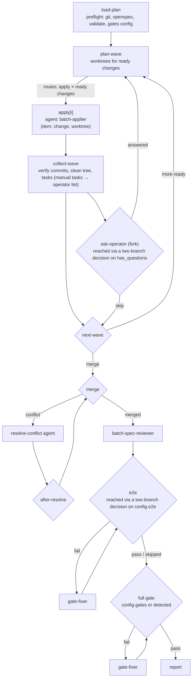

# Design: batch-apply-example

## Context

The local copy (`.pi/flows/flows/batch/apply/`, 16 handlers, 4 agents) works but carries invoice-bot specifics, fixed `apply-1..4` slots, and agent outputs named `status`. The 2026-11-01 run exposed the reserved-name collision, stale agent definitions, and blocking on manual tasks.

## Goals / Non-Goals

**Goals:** run in any git + OpenSpec project with zero config where `package.json` scripts exist; no idle agents; operator questions in the loop; a readable reference example.

**Non-Goals:** pushing, opening PRs or merging into the base (the skill guides the operator); non-OpenSpec task sources; Windows-native git paths.

## Decisions

**D1: Configuration file** `.pi/batch.json` read by `load-plan` and stored into `state.json`, so later nodes and resumes use one frozen copy. Detection logic lives in `batch-lib.mjs` with unit tests (pure).

**D2: Fan-out instead of slots.** `plan-wave` is a `multi: true` code-decision with one branch `apply: { to: apply, for_each: dynamic, max_items: 20 }`. It caps the ready list at `max_items` itself (the rest wait for the next wave), creates worktrees only for those, then returns `{ routes: [{ branch: "apply", items: [<full assignment>] }] }`, or `{ branches: [] }` when nothing is ready. Each item is the full assignment the current `plan-wave.ts` builds (change, branch, worktree, base commit, deps and their handoffs, gate commands, `operator_answer`). The flow's `max_concurrent` caps parallel appliers. `collect-wave` takes `${{result.apply.items}}` whole. This removes the `change/status/handoff × 4` wiring and the idle-agent path.

**D3: Operator questions.** `collect-wave` outputs `questions` (a markdown list per change) and `has_questions`. A two-branch code-decision `has-questions` (`ask` → `ask-operator`, `continue` → next step) routes to the `ask-operator` fork only when there are questions and the run is interactive. The fork has `allowCustom: true`, options `answered`/`skip`; its free text is stored per change in state and given to the next apply as `operator_answer`. In autonomous mode `has-questions` returns `continue`, so no decision agent invents answers.

**D4: Agents.** Outputs are `change`, `outcome`, `handoff`. Prompts take gate commands, worktree setup and `forbid` from the assignment JSON, with no project-specific text. `access:` is removed; isolation comes from an executor if configured (`agent-executor-hook`).

**D5: Planner.** `batch-plan.mjs` moves into the flow dir. Base defaults to the current branch. Dependencies come from "Depends on `x`" lines plus `--dep`/`--nodep`. The plan file goes in `.worktrees/.batch/<name>/`; the planner adds `.worktrees/` to `.git/info/exclude` (local, never committed).

**D6: Skill.** `examples/skills/batch-apply/SKILL.md` (installed with the example, not listed in `pi.skills`) covers when to use it, planning, start (`/batch:apply <plan>`, or `flow_run` when available), monitoring (`state.json`, `report.md`), answering questions, after-green steps, and cleanup. Project-specific operator preferences stay in projects.

**D7: Examples lane.** Discovery keeps its tiers (project, user, packages, built-ins); `examples/` is not a tier. `/flows:examples` reads `examples/flows/*/*/flow.yaml` plus a one-line `example.json` (`name`, `description`, `files`) per example, and `install` copies files with the same layout rules as `flow_write` (bundle dir per flow, agents flat, skill dir). Re-discovery runs after install. *Alternative*: a registered built-in with a disable switch. Rejected: a default flow that creates worktrees and branches should never appear unasked.

## Risks / Trade-offs

- **Git side effects** (worktrees, branches) in the user's repo. All are under `.worktrees/` and `os/*`/`batch/*` branches; the skill documents cleanup; nothing is pushed.
- **Config commands run on the host** with the user's permissions. Documented in `docs/security.md`; an executor confines agents, not code steps.
- **Long runs and model cost.** Bounded by slots, fixer attempts and `max_iterations`; the report shows token totals.
