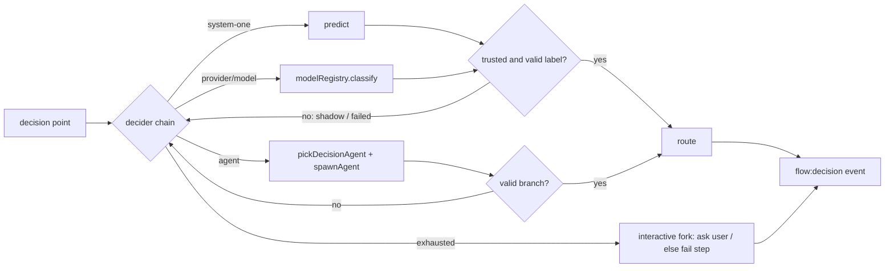

# Design: classifier-decisions

## Context

- Decision code today: `spawnForkDecisionAgent` (autonomous fork, auto-decide, "Other" free text) and `executeAgentDecisionStep` in `extensions/flow-engine/flow-execution.ts`. Both spawn a full agent with `decisionBranches` and fall back to the first branch when `finishParams.branch` is missing or invalid.
- `resolver-agnostic-model-refs` (written, not implemented) adds `flows-settings.ts` (global/project merge, frozen per run), `pickDecisionAgent()` and the session-model fallback for `@role` refs. This change builds on all three.
- pi-ai 1.x: `modelRegistry.classify(model, { state: JsonObject, questions })`; question types `choice | score | bool`; answers carry `probabilities` and `confidence`; usage and cost reported.
- `@blackbelt-technology/pi-system-one` 0.11.0 (npm, Node built-ins only): `predict({ consumer, state: string, questions, signal, project, llmCaller })`. Question types `choice | score | noul`. Result `{ ok, answers, backendId, model, mode, thresholds, attempts }` or `{ ok: false, reason }`. `loadConfig()` is exported, and `calibration["<backend>::<consumer>"]` holds the calibration records. Consumers self-register under `~/.pi/agent/system-one/consumers/`. Decision log stores a hash of the state.
- The dashboard's System One `llm` caller lives in the dashboard server process, so pi-flows cannot reuse it in pi.
- Verified on the dev machine: no pi-ai classifier credentials; a dashboard-written `system-one.json` with backends `jev` (http), `von` (managed), `decision` (llm).

## Goals / Non-Goals

**Goals:**
- One `decide()` path for all agent-made decisions, with classifier entries in front of the agent.
- Same behaviour with and without the dashboard; the dashboard only adds configuration, managed backends and calibration.
- Zero change for flows that don't opt in.
- No silent default branch.

**Non-Goals:**
- `ctx.classify()` for `code-decision` handlers; `flow_run` routing by classifier (follow-up).
- Writing calibration fixtures to disk. The `flow:decision` event carries what a later change needs; the dashboard can persist it.
- `score`/`bool` questions. Every decision is one `choice` question, even with two branches.
- A pi-flows UI for System One configuration (the dashboard owns it).

## Decisions

**D1 — Chain resolution.** `resolveDecider(step, flow, settings)` returns `{ entries, trust, minConfidence }`: step `decider` → flow `decider` → `flows.decider` → `{ entries: ["agent"] }`. `decider` accepts a list shorthand (`[system-one, agent]`) or an object `{ chain: [...], trust, min_confidence }`. Trust settings resolve field by field in the same order. *Alternative*: a separate `classifier:` field next to `agent:` — rejected: it cannot express order or "classifier only".

**D2 — Module layout.** New `extensions/flow-engine/decider/`:
- `chain.ts`: `decide(req): Promise<DecisionOutcome>`. Loops entries, applies trust, checks the label, collects attempts, honours `signal`.
- `question.ts`: builds `{ state, question }` from the step (criteria from `means`, options or labels; state from `state:` or the defaults).
- `system-one.ts`: consumer id, `predict()` call, calibration lookup through `loadConfig()`.
- `pi-ai.ts`: resolves `provider/model` among classifier models and calls `modelRegistry.classify`; maps answers to the shared shape.
- `llm-caller.ts`: the in-process `LlmCaller` for System One.
- `trust.ts`: pure `isTrusted(answer, policy, calibrationExists)`.

The `agent` entry wraps the existing spawn code, refactored out of the two current functions and using `pickDecisionAgent()`.

**D3 — Question mapping.** `choice` with `criteria = { label: means ?? label }` (fork: `{ option: option }`), instructions = expanded `task`, or `question` for a fork without `task`. State = expanded `state:` map, else `{ task }`; fork "Other" adds `{ question, userText }`. System One gets `JSON.stringify(state)`. Answer normalised to `{ label, confidence, probabilities, mode?, model, backendId? }`.

**D4 — Trust.** `calibrated`: `mode === "enforce"`. `confidence`: `confidence >= minConfidence`. `auto`: System One answers check `cfg.calibration[`${backendId}::${consumerId}`]`; if present, require `enforce` (the dashboard's calibration wins, and the System One thresholds are not overridden), else confidence. pi-ai answers have no calibration, so `auto` means confidence. *Alternative*: always trust `enforce` only — rejected: without the dashboard nothing would ever route.

**D5 — Consumer id.** `pi-flows:${flow}:${step}` lowercased, `[^a-z0-9:._-]` → `-`, sliced to 128, matching the library's `CONSUMER_ID`. `label` = `"<flow> › <step>"`, `failurePolicy: "fail-open"` (we fall through ourselves), `requires: { primitives: ["choice"], maxOptions: <branch count> }`. Renaming a flow or step creates a new consumer; documented.

**D6 — In-process `llm` caller.** `call({ role, state, questions, signal })` resolves `role` through the `resolver-agnostic-model-refs` resolver (session-model fallback), then runs **one** completion via `modelRuntime`/`complete` with a JSON-schema-constrained prompt asking for `{ <question>: { choice, probabilities } }`, parses and returns `{ answers, model }`. `isLocal(role)` resolves synchronously from a per-decision snapshot taken before `predict()`: true only for ollama / lmstudio / llama.cpp providers on a loopback base URL, the same rule as the dashboard's caller. No agent session, no tools.

**D7 — Privacy.** pi-ai entries: `loadConfig({ cwd })` once per run; if a config file exists and `allowOffMachine === false`, require the model's `baseUrl` host to pass `isLoopbackHost()` (exported by the library) or fail with `off-machine` before any request. No config → no gate (the agent would send the same state to a hosted model anyway).

**D8 — Failure semantics.** Attempt outcomes: `ok`, `untrusted` (shadow), `invalid-label`, `no-backend`, `off-machine`, `credentials`, `timeout`, `error`, `aborted`. `aborted` stops the chain and propagates the abort. Exhausted chain: fork in interactive mode (auto-decide or "Other") → re-ask with the same options; autonomous fork and `agent-decision` → step fails via the normal failure path (`on_error` honoured where supported) with a message listing attempts. A step failure replaces today's first-branch fallback in both functions.

**D9 — Timeouts.** System One applies its own per-backend timeouts. pi-ai and `llm` calls get a 15 s timeout combined with the run's `signal` via `AbortSignal.any`.

**D10 — Event.** `flow:decision` `{ flowName, stepId, consumerId, chain, attempts: [{ entry, outcome, label?, confidence?, mode?, trusted?, agreed?, model?, latencyMs, usage? }], routedBy, label }`, emitted through the existing observer path (`flow-manager` → `flow-tui` emit → `flow-persist` mapping `flow_decision`). `agreed` is filled after routing for shadow attempts. The existing `flow:auto-decision` event is kept for compatibility. The state and the task text are never included.

**D11 — Parser and validator.** Parser: `decider` on flow and steps; `state` on `agent-decision` and `fork`; branch values accept `{ to, means }` and normalise to `branches: Record<string,string>` plus `branchMeans: Record<string,string>`, so routing code is unchanged. Validator: entry syntax (`system-one` | `agent` | `provider/model`), `trust` enum, `min_confidence` in [0,1], warning for classifier chains with branches lacking `means`. `flow_write` (registry available): `provider/model` must be a known classifier model, else error.

**D12 — Dependency.** Add `@blackbelt-technology/pi-system-one` `^0.11.0` to `dependencies` and import it lazily (`await import`) only when a chain contains `system-one`, so flows without it never load the library or touch `~/.pi/agent/system-one/`.

## Risks / Trade-offs

- **Removing the first-branch fallback** can turn a run that used to "succeed" into a failed step. That is intended: the old behaviour hid errors. Noted as a behaviour change in CHANGELOG.
- **Two processes using System One** (dashboard server and pi) write per-process logs and the same consumer file. The library is designed for this; covered by a test that runs `predict()` twice with the same consumer.
- **Library version drift** with the dashboard: both pin `^0.11.0`; the adapter only uses `predict`, `loadConfig` and `isLoopbackHost`.
- **Confidence is not calibrated across models.** `0.75` is a starting point; `trust: calibrated` plus the dashboard is the stronger option and is documented.
- **No live classifier credentials on the dev machine.** Tests use faux `classify`/`predict` seams; a manual spike against the dashboard config (`jev`, `von`) is a task, not a gate.
- **Consumer churn on rename** loses calibration; documented, not solved.
