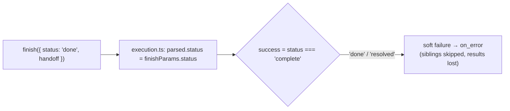

# Design: fix-authoring-validator

## Context

The finish tool's schema merges reserved fields (`status`, `summary`, `files`, `artifacts`, and `branch` for decisions) with an agent's declared outputs, so a declared output of the same name overwrites the reserved meaning. Discovery runs at session start and on `flow:rediscover`; flow runs reuse the cached maps.

## Goals / Non-Goals

**Goals:** catch the collision at authoring time; apply edits without reload; fix each audit item, choosing honour-or-reject per field.

**Non-Goals:** renaming the finish tool's reserved fields (that would break every agent); implementing structured agent outputs.

## Decisions

**D1: Reserved names are an error, not a rename.** The engine could namespace outputs, but that changes the finish schema for every agent. An error with a suggested name is local and explicit.

**D2: Rediscover at run start.** Call the existing rediscovery path in the run entry (`flow:run`, slash command, `runFlow` API) before resolving the flow. Discovery is a directory scan plus parsing a few dozen files, cheap next to an agent run. Validation warnings from rediscovery go to the run log, not the UI.

**D3: Honour or reject.** `on_error` on `fork` / `agent-decision`: honour it (route the soft failure), because both can fail (a missing decision agent, an exhausted decider chain from `classifier-decisions`). Inline-list `inputs`/`outputs`: parse them. `card.type`: drop the warning if the parser ignores the field.

**D4: Verify first.** Each audit item gets a failing test before any code change. Items already fixed by `resolver-agnostic-model-refs` or `classifier-decisions` are ticked with a note, not re-implemented.

## Risks / Trade-offs

- **Agents in downstream packages** that declare `status` start failing validation. Intended; the CHANGELOG names the rename.
- **Rediscovery per run** picks up half-edited files mid-authoring. The run fails validation with a clear error instead of using stale definitions.
