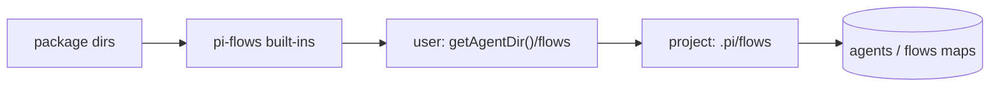

# Design: global-flow-location

## Context

`discoverAll(packageRoot, projectRoot, extraAgentsDirs, extraFlowsDirs)` in `extensions/flow-engine/discovery.ts` fills one `Map` per kind in ascending priority (packages → pi-flows built-ins → project), so later `set()` wins. `flow_agents` classifies sources as `local | package | built-in` by path prefix. `flow-context/index.ts` scans `.pi/flows/flows/` itself for `/flows` and `/flows:delete`. pi exports `getAgentDir()` (honours `PI_CODING_AGENT_DIR`).

## Goals / Non-Goals

**Goals:** one user-level location for flows and agents; precedence project > user > package > built-in; user flows act on the current project; authoring and deletion that know the location.

**Non-Goals:** user-level skills (pi already loads `~/.pi/agent/skills/`); syncing or versioning user flows; a trust prompt for user flows; changing the package registration events.

## Decisions

**D1: Insert the tier in `discoverAll`.** Add `userRoot?: string` (the `flows/` dir under `getAgentDir()`), scanned after built-ins and before project. `index.ts` passes `join(getAgentDir(), "flows")`. Tests pass a temp dir. *Alternative*: register the user dir via `flow:register-flows-dir`. Rejected because packages would then outrank the user, and the source label would read `package`.

**D2: Source tag on items.** `AgentConfig.source` and `FlowConfig.source` already hold the file path. A single `classifySource(path, roots)` returns `project | user | package | built-in`. `flow_agents` and `/flows` both use it, replacing the `local` label with `project`.

**D3: Execution context.** Handler resolution is already relative to the flow file's directory (self-contained bundles). The run's `cwd`, results dir and agent cwd come from the session, not the flow file. The change adds tests that pin this and fixes any path that is derived from `projectRoot + .pi/flows/flows/...` instead of the flow's own directory (audit `flow-generate.ts` scaffolds and the handler loader).

**D4: Authoring scope.** `flow_write` and `flow_agents` get `scope` (TypeBox `Union(Literal("project"), Literal("user"))`, optional). Root = `scope === "user" ? userRoot : join(projectRoot, ".pi", "flows")`. Validation, `.ts.default` scaffolds and re-discovery stay the same. Writing to user scope is still gated by `flows.editFlow`.

**D5: Delete.** `/flows:delete` takes the flow's discovered `source` and deletes its bundle directory only for `project` or `user`. Project-only agents deletion (agents referenced solely by the flow) stays project-only; user agents are never auto-deleted.

**D6: No trust gate.** User files are the user's own, matching pi skills.

## Risks / Trade-offs

- **Shadowing surprises:** a stale user flow hidden by a project flow of the same name. Mitigated by the source label in `/flows`.
- **Handlers that assume project paths** (e.g. `.pi/flows/flows/batch/apply/batch-plan.mjs` in docs or prompts) break when moved to the user dir. That concerns flow authors, and is documented.
- **Cross-project state:** a user flow that writes state next to itself would share it across projects. Documented: write run state under `ctx.cwd`.
