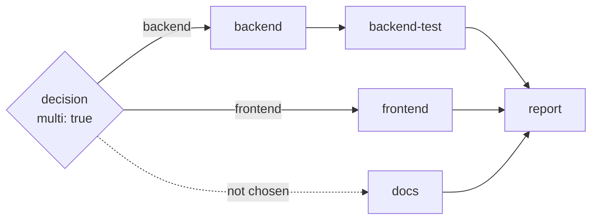

# Design: multi-route-decisions

## Context

How the engine works today (`extensions/flow-engine/flow-execution.ts`):

- **Segments.** `runFlow` splits `flow.steps` into segments (`splitIntoSegments`). A run of consecutive `agent` steps is a DAG segment, scheduled by `runDagSegment` in waves: ready steps, capped by the flow's `max_concurrent`, run under `Promise.all`. Every other step type is a separator and runs alone.
- **Routing.** A decision sets `nextStepId`. `runFlow` jumps to the target's segment and sets `activeSteps = computeActiveSteps(segment, target)`: the target plus the steps forward-reachable from it inside that segment through `blockedBy`. Inactive steps get `skipped` if they have no result yet. The in-segment `on_error` narrowing path already overwrites with `skipped` unconditionally.
- **Skipping optional steps** of any type is already possible: a two-branch decision (`run: e2e`, `skip: <step after e2e>`) jumps past it. A jumped-over separator currently gets **no** result (`${{result.e2e.status}}` is `""`). D9 fixes that, so the skip is visible as `skipped`.

## Goals / Non-Goals

**Goals:**
- several lanes chosen at runtime;
- one agent run per data item;
- deterministic multi-routing from code;
- no new step type;
- single-branch flows and forks unchanged.

**Non-Goals:**
- per-item chains of steps;
- lanes spanning segments;
- per-lane failure isolation;
- multi-route forks;
- multi-label classifiers;
- resumable runs.

## Decisions

### D1: A multi decision returns a list of routes

```ts
type Route = { branch: string; items?: unknown[] };
```

| Node | Single (unchanged) | `multi: true` |
|---|---|---|
| agent-decision | `finish({ branch })` | `finish({ branches: string[] })`: the schema is an array of the branch labels, unique |
| code-decision | `{ branch }` | exactly one of `{ branch }`, `{ branches }` or `{ routes: Route[] }`, plus data outputs |

- **Normalisation:** `branch: x` becomes `[{ branch: x }]`.
- **Branch count:** `multi: true` needs ≥1 branch; a decision without it still needs ≥2.
- **Reserved names:** on a `multi: true` step, `branches`, `routes` and `items` are reserved output names (validation error if declared). Without `multi: true` they stay ordinary data outputs, so existing code-decisions are unchanged.
- **Agent failures:** a label not in `branches:` (the schema enum prevents it), a duplicate, or a missing `branches` is a rejected `finish`. The latch re-prompts, then the attempt fails and the chain continues, as for `branch` today.
- **Code failures** (multi only): an off-map label is a hard failure, as for `branch`. Duplicate labels, more than one routing key, no routing key, or a non-array `items` is a soft failure naming the step.

### D2: Chosen targets activate the next segment



**Validation.** Every forward branch target of a `multi: true` decision must be an `agent` step in the DAG segment immediately after the decision. Backward targets are allowed (D5).

**After a multi decision returns forward routes `R`:**
- **Activation:** `runFlow` jumps to that segment with `activeSteps = ⋃ computeActiveSteps(segment, t)` for `t ∈ R`. A step reachable from any chosen target runs. This is the existing reachability rule, so `report` above runs after `backend-test` and `frontend`, and the skipped `docs` counts as settled.
- **Overwrite:** steps outside `activeSteps` get `skipped`, replacing any earlier result. Today the engine only writes `skipped` when no result exists; that rule stays for single routes.
- **Choosing nothing** (`R = ∅`): every step of the segment is `skipped` and execution continues after the segment.
- **Freshness:** `activeSteps` is assigned freshly each time a decision routes into the segment. The segment also carries a mode flag (`overwriteSkipped`) set by the routing decision, so a later single route or `on_error` into the same segment uses the existing rules.
- **No segment after the decision:** if a multi decision is the last step, or nothing follows it, that is a validation error.

**Concurrency.** Chosen lanes run in parallel because they are ready at the same time in `runDagSegment`, under the flow's `max_concurrent`.

### D3: Fan-out replicates the target step

**Fan-out targets are declared statically.** A branch is a fan-out branch only if it declares `for_each:` (a template) or `for_each: dynamic` (items come only from a code-decision's `routes[].items`). The validator knows every fan-out target from the YAML. A fan-out target must not be reachable from any other branch's target, so it can never run as an ordinary lane.

**Where items come from.** A chosen fan-out route gets items from, in order:
1. `routes[i].items` (code-decision);
2. the branch's `for_each:` template.

For a fan-out branch, missing items mean `[]`. A code route that gives `items` for a non-fan-out branch is a soft failure. Two labels mapping to the same target in one multi decision are a validation error.

**`for_each` expansion:**
- It is expanded after the decision's own result is stored, so it may reference the decision's outputs.
- It must resolve to an array: a typed output, or a string that parses as a JSON array.

**`max_items`.** Per branch, default 50, range 1–1000. It applies to both sources.

**Instances.** A route with items runs **only the target step** once per item, as instances `t[0..n-1]`:
- they are scheduled by `runDagSegment` as extra ready nodes in place of `t`, sharing `max_concurrent`;
- steps blocked by `t` wait for all instances and run once;
- each instance gets its own template context (no shared overlay): `${{item}}` (strings raw, others compact JSON), `${{item.<field>}}` (one level, `""` if absent) and `${{item_index}}` (0-based).

**Aggregate result.** After all instances settle, `results[t]` is:
- `items`: per-instance `{ status, summary, fullOutput, outputs }` in input order;
- `status`: `complete` if every instance completed, else `error`;
- `summary`: `"<n> items: <c> complete, <f> failed"` (an empty list gives `"0 items"` with status `complete`);
- `fullOutput`: `""`;
- `outputs`: `{}`.

**Validation** (step-scoped template scan, which now also covers `for_each`):
- `${{item…}}` is allowed only in the task or inputs of a fan-out branch target;
- `${{item}}`, `${{item.<field>}}` and `${{item_index}}` are also expanded in the target agent's `.md` body;
- `.items` is a standard field of fan-out targets: the validator accepts `${{result.<fanoutTarget>.items}}`; text expansion gives compact JSON, and a whole-value code input gives the typed array. It is stored as a top-level `items` field of the step result, not in `outputs`;
- `${{result.<fanoutTarget>.<declaredOutput>}}` is an error that points to `.items`;
- a fan-out target must not declare an output named `items`.

**Item errors** soft-fail the decision (D4):
- `for_each` not resolving to an array;
- more items than `max_items`.

### D4: Failures

**The decision.** A soft failure after routing, from item expansion or the cap, replaces the decision's stored result with an `error` result (failure message as summary). The decision's `on_error` then routes, or the flow halts. No lane starts.

**Lanes** follow the existing segment rules unchanged. A soft failure with `on_error` outside the segment skips the remaining steps of the segment (including other lanes) and routes; inside the segment, it narrows to the `on_error` target's reachable steps, skipping sibling lanes too; without `on_error` it halts. This is a documented trade-off: lanes are not failure-isolated in v1.

**Instances:**
- One instance's soft failure does not abort its siblings.
- After all instances settle, a failed aggregate (`status: error`) routes like a soft failure of `t` itself: `t`'s `on_error`, else halt.
- Items follow the normal soft/hard rule. A soft failure (e.g. `blocked`) lets the siblings finish, then routes to `on_error`, or halts if there is none. A hard failure aborts the others and halts.
- If the segment is cut short (another step's routed failure, a halt or an abort), completed instances keep their results in `items`, unstarted ones are recorded as `skipped` (or `aborted`), and the aggregate status is `error`.
- `FlowResult.lastResult` after a fan-out is the aggregate.

### D5: Loops

- A multi decision may declare backward branches.
- Returning a backward branch alone loops as today (`max_iterations` counts loop-backs).
- Returning it together with other routes is a soft failure of the decision, naming the branches.
- When the cap is reached and the backward branch is chosen again, the multi decision acts as `branches: []` (D2): the segment is skipped and execution continues after it. This differs from a single decision, which falls through.

### D6: Classifiers

- For a `multi: true` decision, classifier entries are removed from the resolved chain before deciding; if nothing is left, `[agent]` is used.
- `flow:decision.chain` shows the filtered chain; no attempt is recorded for removed entries.
- An explicit step-level `decider:` with a classifier entry on a multi decision is a validation error.
- A flow-level or settings chain is filtered silently.

### D7: Events and display

**`flow:decision`** (agent-decision only, as today):
- adds `labels: string[]` (returned order) and `routes: [{ branch, itemCount? }]`;
- `label` is the first label, absent when none was chosen (with `routedBy` present);
- is emitted after item expansion;
- on an expansion or cap failure, carries `routeError`.

**Code-decisions** still do not emit `flow:decision`.

**Instances:** every per-agent event (`flow:agent-started`, `-complete`, `-error`, `flow:assistant-text`, `flow:thinking-text`, `flow:subagent-tool-call` / `-result`) carries `itemIndex` and `itemCount`.

**TUI:** keys instance cards as `<stepId>[i]` (D9). Other cards and the loop badge keep their current keys.

### D8: Decision-agent prompt and finish

- For `multi: true`, `decisionAgentContext` says "call finish with `branches`: zero or more of these labels".
- `describeBadFinish` reports a missing or invalid `branches` instead of `branch`.
- The finish schema for multi decision agents has `branches` and no `branch`. `finish({ branch })` on a multi agent-decision is a rejected finish. `branch: x` stays valid for code-decisions and for single agent-decisions.
- The built-in `agents/flow-decision.md` body says to pick one label, or several when the context asks for `branches`.
- `branches` is reserved only for agents used by a `multi: true` decision (`reserved-outputs.ts`, validator), so existing single-route flows are unaffected.
- `flow-generate.ts` scaffolds multi handlers with the return type `{ branch } | { branches } | { routes }`.

**Decider chain carries a list.** A multi decision agent calls `finish({ branches: [...] })`. The decider types carry `labels: string[]` end to end: `DecisionAnswer`, `DecisionOutcome` (`ok: true` with `labels`, possibly empty) and `DecisionAttempt`. `decide()` checks every label against the branch list (`invalid-label` names the bad one), and an empty list is a valid answer meaning "nothing chosen". Single decisions keep `label` (a one-element list internally). `flow:decision` gets `labels`, and `label` is kept for single decisions.

### D9: Precise rules

**Code-decision return checks**, in this order:
1. exactly one routing key;
2. type checks (array of strings; `items` an array);
3. off-map labels (hard);
4. duplicates (soft);
5. `max_items` (soft, naming the branch);
6. declared data outputs (existing contract).

Without `multi: true`, `branches` and `routes` are ordinary keys and must be declared as outputs, like any other key.

**`for_each` values:**
- resolving to `""` (unresolved or skipped upstream) means `[]`;
- non-array values soft-fail;
- `max_items` is a branch field (`branches: { x: { to, for_each, max_items } }`), and a value outside 1–1000 or a non-integer is a validation error.

**Skipped results:** when a decision's forward branch jumps over steps that are themselves targets of that decision's other branches (or lie between the decision and the chosen target in the same segment run), those steps get a `skipped` result if they have none. Steps in unrelated intermediate segments are not marked.

**Skipped fan-out target:** a fan-out target that is skipped (not chosen, or nothing chosen) stores `items: []`, so `${{result.<t>.items}}` is always a list.

**Mixed backward and forward return:** the loop counter is not incremented before the soft failure.

**`flow:decision`:** `label` is absent and `routedBy` present when the agent chose nothing. `attempts[].labels` holds the list. `docs/events-api.md` is updated to say that a missing `label` with `routedBy` present means "nothing chosen".

**Item-run events:** `onExtensionUIRequest` (`ask_user` from an instance) also carries `stepId` and `itemIndex`. The observer callbacks in `docs/public-api.md` gain an optional `item?: { index, count }` argument.

**Classifiers:** `system-one` counts as a classifier entry for D6.

**TUI:** instance cards are keyed `<stepId>[i]`, not by agent name, so two fan-out steps sharing one agent don't collide.

## Risks / Trade-offs

- **One step per item.** A per-item chain (explore → summarize) has to be done inside one agent, or as a second fan-out after a code step. Accepted; it keeps instances independent and unambiguous.
- **Lanes share segment failure rules.** One lane's routed failure can skip the others. Accepted for v1. There is no in-segment workaround: in-segment `on_error` narrowing also skips sibling lanes. A flow that needs isolation routes `on_error` outside the segment and handles the failure there.
- **Wave scheduler.** Instances are scheduled in `Promise.all` waves. A pool is a follow-up.
- **Dashboard lag** until the companion repo keys instance cards.
