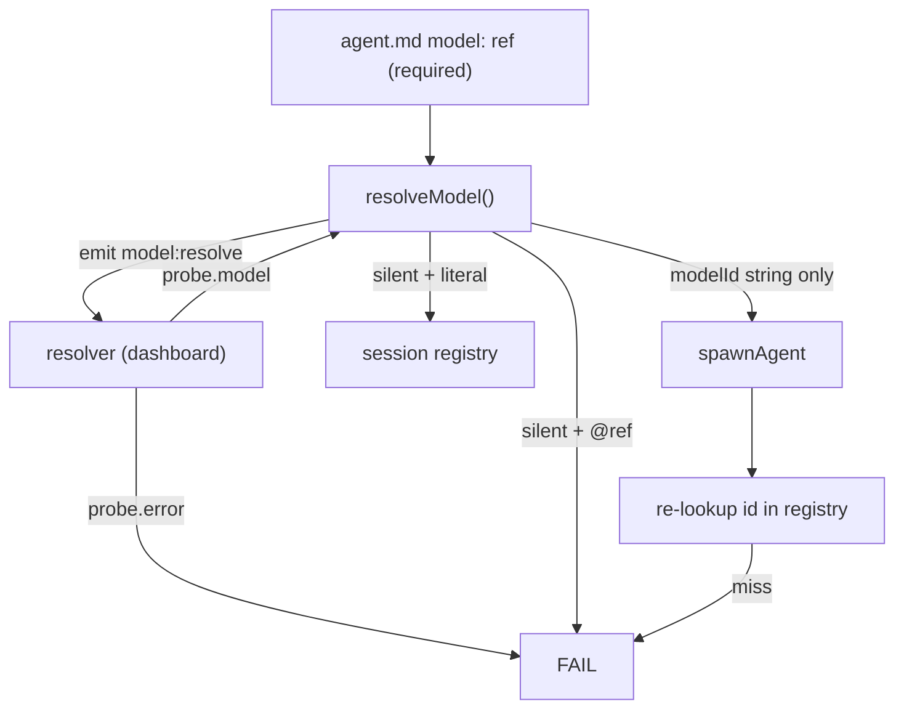
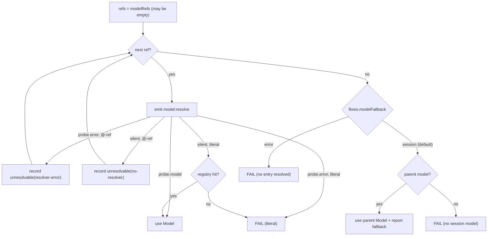

## Context

See proposal.md. Current state (pi 1.0.3):

- Only pi-agent-dashboard registers `model:resolve` (`provider-register.ts:1190`). Its handler sets `probe.model`/`probe.error` before any `await`.
- `ExtensionContext.model`, `pi.on("model_select")` and `pi.getThinkingLevel()` exist.
- `fork` already defaults to `flow-decision` (`flow-execution.ts:789`); `agent-decision` requires `agent:` (`flow-parser-yaml.ts:197`).
- Settings are read by `edit-flow-config.ts` (project overrides global, no trust gate).

## Goals / Non-Goals

**Goals:** legacy single refs unchanged where they resolve today; no failure just because roles are unavailable; pi-flows holds no role names; decision agent configurable once per flow / project.

**Non-Goals:** pi-flows defining or storing roles (no alias map — that is the resolver's job); an async `model:resolve` protocol; per-role fallback models in settings.

## Decisions

**D1 — Resolution chain (one function in `model-roles.ts`).**

Returns `{ model, modelId, thinking, fallback?: { requested: string[], reason } }`. Literal refs never get skipped: a typo must surface. *Alternative*: pi-flows-side alias map (`flows.models`) — rejected, re-creates role ownership that belongs to the resolver.

**D2 — Frontmatter shape stays backward compatible.** `agent-parser.ts` accepts `model: x`, `model: [x, y]`, a block list, or nothing. `AgentConfig.model?: string` keeps the first ref (display, catalog, existing consumers); new `AgentConfig.modelRefs: string[]` holds the full ordered list. Only the resolution code reads `modelRefs`.

**D3 — Parent model snapshot.** `index.ts` keeps `sessionModel` from `ctx.model` at `session_start`, on `model_select`, and from the flow command handler's ctx. `flowManager.start` snapshots `{ model, thinking: pi.getThinkingLevel() }` into `FlowRunOptions.parentModel`; mid-flow model switches do not affect a running flow. Thinking on fallback: `agent.thinking ?? parentModel.thinking`.

**D4 — Settings.** New `flows-settings.ts` beside `edit-flow-config.ts` reusing its global/project merge: `flows.modelFallback` (`"session"` | `"error"`, default `"session"`) and `flows.decisionAgent` (agent name). Read at flow start and frozen for the run.

**D5 — Decision-agent selection.** One helper `pickDecisionAgent(step, flow, settings)` implementing step → `flow.decision_agent` → `flows.decisionAgent` → `"flow-decision"`, used by `spawnForkDecisionAgent` and `executeAgentDecisionStep`. Parser: `decision_agent` on `FlowConfig`; `agent` optional on `agent-decision`. Validator: warn (not error) when a named decision agent is unknown at write time; runtime fails per spec.

**D6 — Carry the `Model` object.** `SpawnOptions.resolvedModel?: Model`; `flow-execution.ts` passes the D1 result to all three `spawnAgent` sites; `execution.ts` uses it and only resolves itself when absent. The registry re-lookup by id is removed for the resolved path.

**D7 — Reporting.** The D1 `fallback` info is attached to `onAgentStarted` extra → `flow:agent-started` payload (`modelFallback: { requested, used, reason }`) and the card shows the used model. No separate notification spam.

**D8 — Validator & write-time probe.** `agent-validate.ts`: delete `KNOWN_MODEL_ROLES`; check each ref's syntax and `:thinking` against exported `VALID_THINKING_LEVELS`; `model` not required. `flow_agents` write: emit for each `@`-ref; `probe.error` → warning text "`<ref>`: <message>; will fall back per flows.modelFallback". Pure validator stays pure.

**D9 — Built-ins unchanged.** `flow-decision.md` keeps `model: "@fast"`, `project-context-reader.md` keeps `model: @coding`; D1 makes them work without a resolver. (`flow-decision.md`'s `tools: []` validation error is out of scope here — authoring-validator change.)

**D10 — Docs via subagent** (AGENTS.md rule for `docs/`); README/AGENTS.md/CHANGELOG directly.

## Risks / Trade-offs

- [Silent cost increase when a cheap role falls back to an expensive session model] → reported on event + card (D7); `flows.modelFallback: "error"` for strict setups; documented.
- [Resolver error for an `@`-ref now falls back instead of failing — a typo'd role (`@codng`) runs on the session model] → write-time warning (D8) catches it at authoring; runtime report shows reason `resolver-error`.
- [`modelRefs` vs `model` drift in consumers] → only `model-roles.ts` reads `modelRefs`; test asserts `model === modelRefs[0]`.
- [No session model in bare event-bus starts] → explicit failure message (D1).

## Migration Plan

Non-breaking minor release. Existing agents need no edits. CHANGELOG documents the new fallback, `flows.modelFallback`, list syntax, `decision_agent:` / `flows.decisionAgent`. Rollback = revert; no persisted state.
